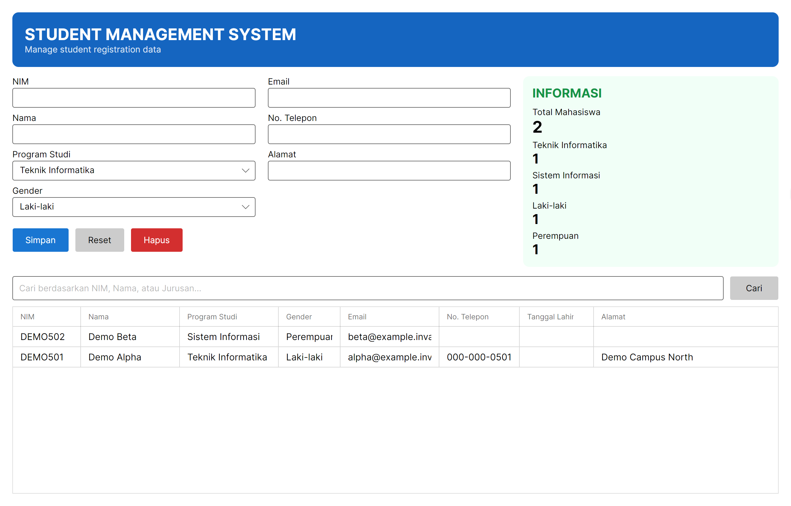
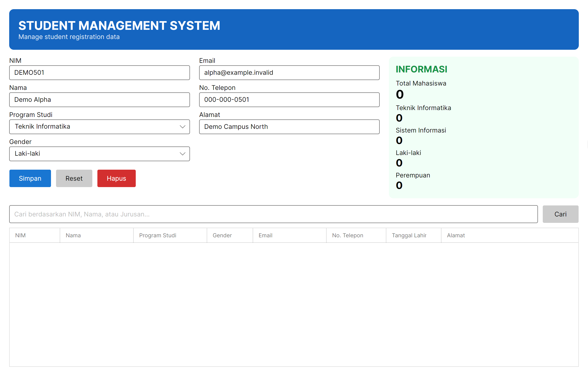
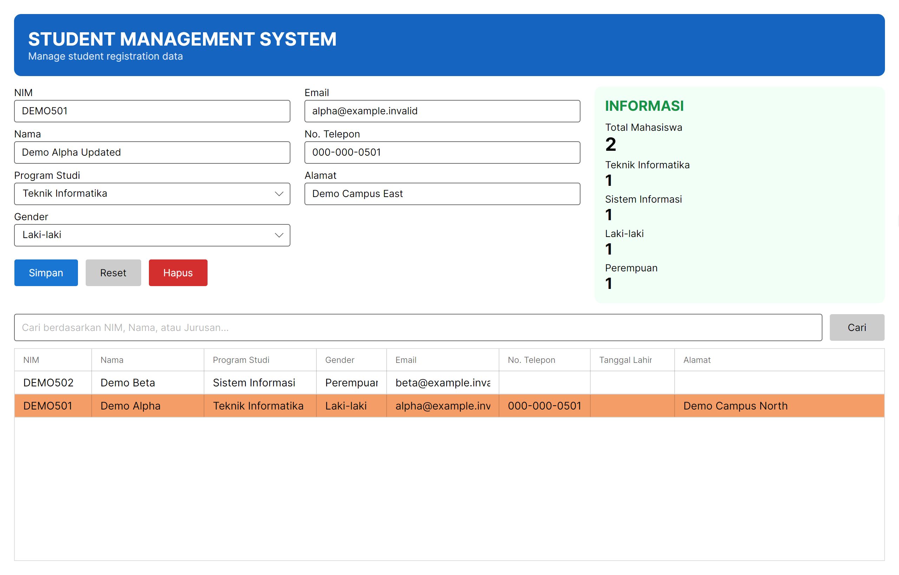
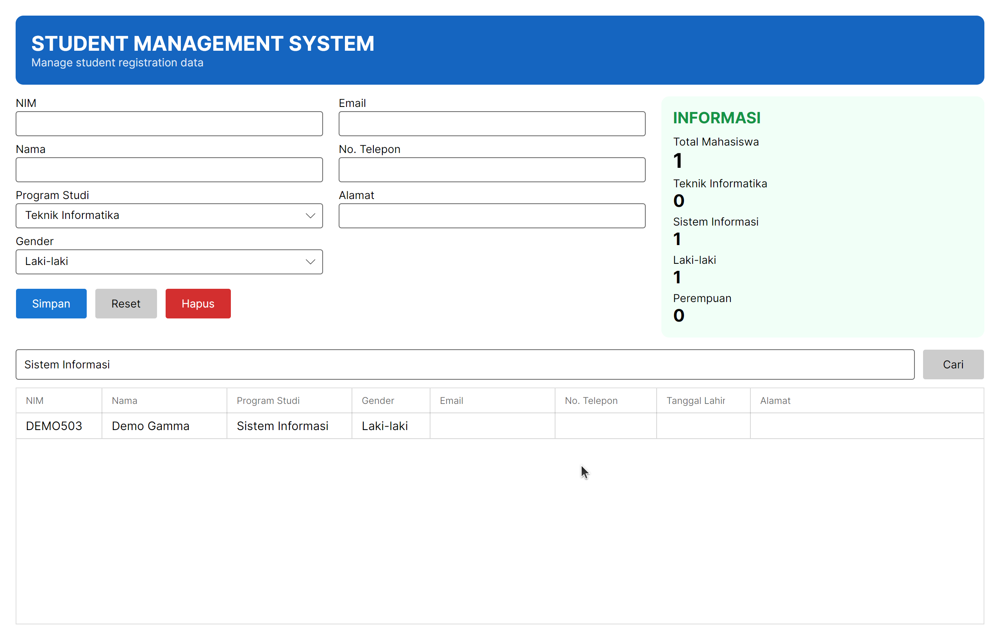
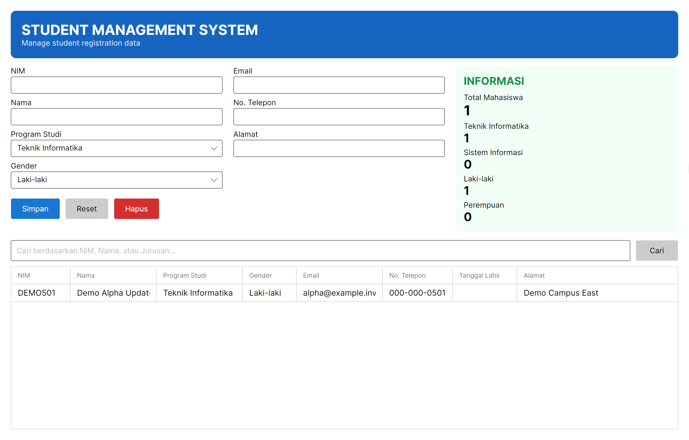

# Student Management System

Manage student registrations in SQL Server through a desktop form, searchable student list, and summary dashboard. Students belong to study programs, and their program names appear alongside contact details in the results grid.



The dashboard shows registrations with totals by study program and gender.

## Features

- Add student registrations and edit existing records through the form.
- Select and delete saved registrations.
- Search by NIM, name, or study program.
- Choose active study programs from the database.
- View totals for the current results, including program and gender counts.
- Store registrations in SQL Server across application sessions.

The form includes NIM (student identifier), name, program, gender, email, phone, and address. The grid also displays stored birth dates. Search uses SQL `LIKE` matching; an empty search reloads the full student list.

## Screenshots



Enter registration and contact details before saving.



Select a row to edit a copy of its saved values. Save applies the changes; Reset discards the edits.



Searching by program narrows the list and updates the summary counts.



The list and statistics update after deletion.

## Tech Stack

C# and .NET 10, Avalonia with Fluent styling, SQL Server, and Microsoft.Data.SqlClient.

## Architecture

The interface follows MVVM. Data bindings connect the form, grid, and dashboard to `StudentViewModel`, which exposes observable collections, property notifications, and commands for save, delete, reset, and search.

Grid selection and the editable student copy are separate properties. This lets the form hold unsaved changes while the grid retains the saved record. `StudentRepository` handles database access through parameterized SQL and joins students with their study programs.

| Path | Responsibility |
| --- | --- |
| `StudentManager/MainWindow.axaml` | Form, grid, search, and dashboard bindings |
| `StudentManager/ViewModels/` | Selection, editable state, commands, and statistics |
| `StudentManager/Models/` | Student and study program models |
| `StudentManager/Data/StudentRepository.cs` | SQL queries and record mapping |
| `database/schema.sql` | Database tables, constraints, and initial programs |

## Getting Started

### Requirements

- .NET 10 SDK.
- A graphical desktop supported by Avalonia.
- A running SQL Server instance.
- NuGet access for the initial package restore.

From the repository root:

```sh
dotnet restore StudentManager/StudentManager.csproj
dotnet build StudentManager/StudentManager.csproj
```

Complete the database and connection configuration below before launching the application.

### Configuration

Create a new, empty SQL Server database named `PortfolioWeek5`. Select it in your SQL client and execute [database/schema.sql](database/schema.sql). The script requires that database name and an empty application schema. It creates the tables in a transaction and adds two study programs.

| Table | Data |
| --- | --- |
| `Programs` | Program ID, unique code, name, and active status |
| `Students` | Student ID, unique NIM, name, program ID, gender, email, birth date, address, phone, and timestamps |

`Students.ProgramId` references `Programs.ProgramId`. The schema enforces unique student identifiers and permits NULL values for optional contact details and birth dates. The repository sets `UpdatedAt` when a record is edited.

Use a setup account to create the schema. The application login needs `SELECT` on `dbo.Programs` and `SELECT`, `INSERT`, `UPDATE`, and `DELETE` on `dbo.Students`.

Set `STUDENT_MANAGER_CONNECTION_STRING` in the environment of the process launching the app. Use [.env.example](.env.example) as the connection-string template and supply your own server, port, database, and credentials. The variable must be exported explicitly; the application does not load `.env` files automatically.

In Bash, read the connection string without echoing it or storing it in shell history:

```sh
read -r -s -p 'SQL Server connection string: ' STUDENT_MANAGER_CONNECTION_STRING
printf '\n'
export STUDENT_MANAGER_CONNECTION_STRING
dotnet run --project StudentManager/StudentManager.csproj
unset STUDENT_MANAGER_CONNECTION_STRING
```

For a containerized SQL Server, use its published host port in the connection string. The template's `TrustServerCertificate=True` setting is for trusted local development; use certificate validation for other environments.

## Usage

Enter a unique NIM and student details, choose a program, and select **Simpan** (Save). Select an existing row to load its values into the editor, then save to update that registration.

**Reset** clears the selection and starts a new form. **Hapus** (Delete) removes the selected saved record. Enter a search term and select **Cari** (Search); clear the term and search again to show all students. Dashboard counts always describe the currently loaded results.
